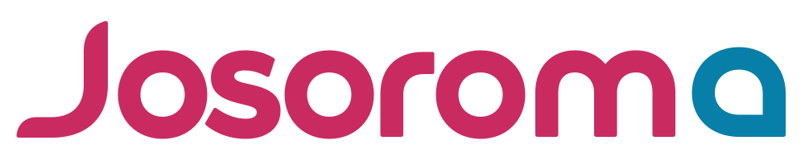

  <picture>
    <source media="(prefers-color-scheme: dark)" srcset="art/readme/logo-dark.svg">
    
  </picture>
  &nbsp;&nbsp;por&nbsp;&nbsp;
  

  <picture>
    <source media="(prefers-color-scheme: dark)" srcset="art/readme/cover-dark.svg">
    
  </picture>

<h1 align="center">La segunda pregunta</h1>

<strong>Las máquinas escriben el primer borrador. Nosotros entrenamos a la persona que responde por él.</strong>

  <a href="https://josoroma.github.io/The-Second-Question/es/"><strong>Léalo gratis</strong></a> ·
  <a href="https://josoroma.github.io/The-Second-Question/"><strong>Read it in English</strong></a> ·
  <a href="book/es/README.md">Markdown</a> ·
  <a href="book/es/BOOK.md">Un solo archivo</a> ·
  <a href="README.md">README in English</a>

---

## Qué es

Un programa de entrenamiento en forma de libro gratuito, para quienes construyen cosas y después tienen que lograr que otras personas entiendan, estén de acuerdo y actúen. Treinta y ocho lecciones, noventa y seis prácticas, un plan de treinta días y un sitio con figuras animadas en 3D. Todo en Markdown, en español y en inglés.

## El problema

Un texto fluido cuesta poco ahora. Cualquiera, o cualquier asistente, puede preparar la primera respuesta: el avance, la especificación, la propuesta, el pitch. Por eso la prueba de que usted entiende pasa a la pregunta que viene después.

> "Usted dice que la integración va en camino. ¿De qué depende la fecha de setiembre?"

Si aprobó el borrador sin decidir qué dice, ahí se da cuenta. Pasa en la junta directiva, en la demo, en la conversación de salario y en el pull request, delante de la persona que decide.

## Qué hacemos

Entrenamos un solo movimiento hasta que aguante la presión. Antes de hablar, firmar o enviar, responda cinco preguntas sobre la afirmación, sea suya, de un colega o de una máquina:

1. **¿Cuál es el punto?**
2. **¿En qué se apoya?**
3. **¿Hasta dónde llega?**
4. **¿Qué quiere de mí?**
5. **¿Quién responde por esto?**

La llamamos *la prueba de la segunda pregunta*. Cada lección la lleva a una sala distinta.

## Pruébelo en tres minutos

1. Abra la grabadora de su celular. Responda en voz alta, sesenta segundos, sin prepararse: **¿en qué está trabajando y por qué importa?**
2. Escriba en papel la única frase que quería que llegara.
3. Póngale la grabación a alguien de fuera de su trabajo. Pídale que escriba su punto en una frase.

Compare las dos frases. Si coinciden, tal vez no necesite este libro. Si no, [empiece aquí](https://josoroma.github.io/The-Second-Question/es/read/01-start-here/).

## Para quién es

| Usted | El momento | Abra |
|---|---|---|
| Fundó una empresa | Alguien que invirtió le pregunta de qué depende su fecha | [El avance](book/es/17-the-update.md) |
| Trabaja por su cuenta | Un cliente pregunta el precio y usted explica por cuatro minutos | [Diga menos](book/es/07-say-less.md) |
| Hace ingeniería con el cliente, o desde otro país | Le dieron un "sí" del que desconfía, en su segunda lengua | [Entre fronteras](book/es/24-across-borders.md) |
| Hace ingeniería o arquitectura | Lo escribió un agente y debajo va su nombre | [Ingeniería y arquitectura](book/es/33-engineers-and-architects.md) |
| Trabaja en ciencia de datos | Quien patrocina quiere un número más grande que el que dan los datos | [Ciencia de datos](book/es/34-data-scientists.md) |
| Lleva producto o un equipo ágil | Termina la planificación y nadie sabe qué se decidió | [La reunión](book/es/15-the-meeting.md) |
| Tiene enfrente a alguien difícil | Interrumpe, se queda en silencio o sigue moviendo la fecha | [Personas difíciles](book/es/27-difficult-people.md) |

Veintisiete momentos, cada uno con su capítulo, su herramienta y su práctica, están en [Encuentre su momento](book/es/00b-situation-finder.md).

## Qué recibe

| | |
|---|---|
| **38 lecciones en seis partes** | Mente clara, voz clara, conexión clara, las salas, fricción, lo que sigue siendo humano |
| **96 prácticas** | Cada una con un "listo significa" que una persona ajena podría comprobar |
| **Un plan de 30 días** | De diez a quince minutos al día, y una versión de 12 semanas |
| **13 prompts de entrenamiento** | Pegue uno en cualquier asistente y ensaye contra alguien que insiste |
| **98 frases y más de 20 plantillas** | Para cuando sus propias palabras no están a mano |
| **25 recuadros de investigación, 2 mitos a prueba** | Cada uno atado a un estudio publicado, con el punto hasta donde llega |
| **45 figuras** | Dibujadas en código, animadas, y se pueden girar en 3D |

## Por qué ahora

Los asistentes y los agentes abarataron el primer borrador. Elegir qué debe decir, revisar lo que dejó por fuera y responder por él no se abarató. Nuestra apuesta es que esas habilidades valen más mientras la gente firme por su trabajo, y que se entrenan como cualquier otra.

## Por qué es distinto

- **Se entrena en voz alta.** Usted se graba al comienzo, al final de cada parte y al final del libro, y se compara solo con usted.
- **Dice dónde falla.** Cada lección cierra con cuándo sale mal el consejo, y qué cambia cuando la otra persona tiene poder sobre usted.
- **Se califica a sí mismo.** [¿Qué tanta seguridad tenemos?](book/es/95-how-sure-are-we.md) lista las afirmaciones principales, en qué se apoya cada una y qué nos haría cambiar de opinión.
- **Una segunda lengua es lo normal.** La mayoría de las personas de sus escenas trabaja en una, incluidas las de mayor rango. A nadie se le pide perder el acento.
- **Una habilidad, dos oyentes.** El encargo que es claro para un colega es claro para un agente.

## Dónde estamos

Día uno. El libro está completo en los dos idiomas y se lee gratis. No tiene usuarios que citar ni resultados que mostrar, así que no citamos ninguno. Ningún estudio ha probado el libro completo.

Qué contaríamos como señal de que funciona: que la frase de quien le escucha, puesta al lado de la que usted quiso decir, coincida más veces después de treinta días que el primero.

## Qué pedimos

- **Haga los tres minutos de arriba** y [abra un issue](https://github.com/josoroma/The-Second-Question/issues) con las dos frases, la suya y la de quien le escuchó. Deje por fuera todo lo confidencial.
- **Rompa una afirmación.** Elija una fila de [¿Qué tanta seguridad tenemos?](book/es/95-how-sure-are-we.md) y traiga un registro, una fecha o una repetición que falló. Un contraejemplo comprobado vale más que cualquier etiqueta de esa tabla.
- **Lea la edición en español** y díganos qué suena traducido.

## Cómo se hizo

Agentes de IA redactaron el libro en noviembre de 2026, a partir del encargo del autor y bajo su dirección. También agentes tradujeron la edición en español; si algo no coincide, vale el inglés. Cada frase que dice que la investigación muestra algo está atada a un estudio publicado, y casi todos esos estudios se leyeron en sus resúmenes. Las personas, las empresas y las escenas son inventadas, incluidas las de la nota del autor. El autor responde por él.

Hecho en Costa Rica.

## Licencia

El libro y sus figuras son [CC BY-NC 4.0](https://creativecommons.org/licenses/by-nc/4.0/deed.es): puede compartirlos y adaptarlos sin fines comerciales, con crédito. El código es [MIT](LICENSES/MIT.txt). Los logos, todos los derechos reservados. Los detalles están en [LICENSE.md](LICENSE.md).

La parte técnica (el sitio, las figuras y cómo correrlo) está en el [README en inglés](README.md#for-developers).
