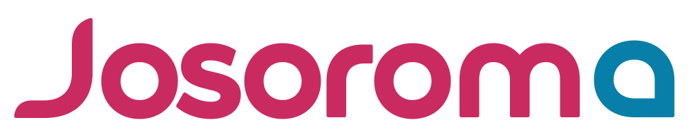

<p align="center">
  <picture>
    <source media="(prefers-color-scheme: dark)" srcset="art/readme/logo-dark.svg">
    
  </picture>
  &nbsp;&nbsp;<sub>by</sub>&nbsp;&nbsp;
  <a href="https://github.com/josoroma"></a>
</p>

<p align="center">
  <picture>
    <source media="(prefers-color-scheme: dark)" srcset="art/readme/cover-dark.svg">
    
  </picture>
</p>

<h1 align="center">The Second Question</h1>

<p align="center"><strong>Machines write the first draft. We train the person who has to answer for it.</strong></p>

<p align="center">
  <a href="https://josoroma.github.io/The-Second-Question/"><strong>Read it free</strong></a> ·
  <a href="https://josoroma.github.io/The-Second-Question/es/"><strong>Léalo en español</strong></a> ·
  <a href="book/README.md">Markdown</a> ·
  <a href="book/BOOK.md">One file</a> ·
  <a href="README.es.md">README en español</a>
</p>

---

## What it is

A training program in the form of a free book, for people who build things and then have to get other people to understand, agree and act. Thirty-eight lessons, ninety-six practices, a thirty-day plan, and a website with animated 3D figures. Everything is plain Markdown, in English and Spanish.

## The problem

Smooth text costs little now. Anyone, or any assistant, can prepare the first answer: the update, the spec, the proposal, the pitch. So the test of understanding moves to the question that comes next.

> "You say the integration is on track. What does the September date depend on?"

If you approved the draft without deciding what it says, that is where you find out. It happens in the board meeting, the demo, the salary talk and the pull request, in front of the person who decides.

## What we do

We train one move until it holds under pressure. Before you speak, sign or send, answer five questions about the claim, whether it is yours, a colleague's or a machine's:

1. **What is the point?**
2. **What does it rest on?**
3. **Where does it stop?**
4. **What do you want from me?**
5. **Who answers for it?**

We call it *the second-question test*. Every lesson takes it into a different room.

## Try it in three minutes

1. Open your phone's recorder. Answer aloud, for sixty seconds, without preparing: **what are you working on, and why does it matter?**
2. On paper, write the one sentence you meant to get across.
3. Play the recording to someone outside your work. Ask them to write your point in one sentence.

Compare the two sentences. If they match, you may not need this book. If they don't, [start here](https://josoroma.github.io/The-Second-Question/read/01-start-here/).

## Who it is for

| You are | The moment | Open |
|---|---|---|
| A founder | An investor asks what your date depends on | [The update](book/17-the-update.md) |
| A solo operator | A client asks the price, and you explain for four minutes | [Say less](book/07-say-less.md) |
| A forward-deployed or offshore engineer | You were given a "yes" you don't trust, in your second language | [Across borders](book/24-across-borders.md) |
| An engineer or architect | An agent wrote it, and your name goes under it | [Engineers and architects](book/33-engineers-and-architects.md) |
| A data scientist | Your sponsor wants a bigger number than the data gives | [Data scientists](book/34-data-scientists.md) |
| A product manager or agile lead | Planning ends, and nobody can say what was decided | [The meeting](book/15-the-meeting.md) |
| Anyone facing someone difficult | They interrupt, go silent or keep moving the date | [Difficult people](book/27-difficult-people.md) |

Twenty-seven moments, each with its chapter, its tool and its practice, are in [Find your moment](book/00b-situation-finder.md).

## What you get

| | |
|---|---|
| **38 lessons in six parts** | Clear head, clear voice, clear connection, the rooms, friction, what stays human |
| **96 practices** | Each has a "done means" that a stranger could check |
| **A 30-day plan** | Ten to fifteen minutes a day, and a 12-week version |
| **13 sparring prompts** | Paste one into any assistant and rehearse against someone who pushes back |
| **98 phrases and 20-odd templates** | For the moment when your own words are not close enough |
| **25 research callouts, 2 myth checks** | Each tied to a published study, with the place where it stops |
| **45 figures** | Drawn in code, animated, and turnable in 3D |

## Why now

Assistants and agents made the first draft cheap. Choosing what it should say, checking what it left out and answering for it did not get cheaper. Our bet is that those skills gain value for as long as people sign for work, and that they can be trained like any others.

## Why it is different

- **It trains you out loud.** You record yourself at the start, at the end of each part, and at the end, and compare only with yourself.
- **It says where it fails.** Every lesson closes with when the advice backfires, and what changes when the other person has power over you.
- **It grades itself.** [How sure are we?](book/95-how-sure-are-we.md) lists the main claims, what each rests on, and what would change our mind.
- **A second language is normal.** Most of the people in its scenes work in one, the most senior among them. Nobody is asked to lose an accent.
- **One skill, two listeners.** The brief that is clear to a colleague is clear to an agent.

## Where we are

Day one. The book is complete in both languages and free to read. It has no users to quote and no results to show, so we quote none. No study has tested the book as a whole.

What we would count as working: your listener's sentence, set beside the one you meant, matches more often after thirty days than on the first.

## What we ask

- **Do the three minutes above**, then [open an issue](https://github.com/josoroma/The-Second-Question/issues) with the two sentences, yours and your listener's. Leave out anything confidential.
- **Break a claim.** Choose a row in [How sure are we?](book/95-how-sure-are-we.md) and bring a record, a date or a failed repeat. A checked counterexample outranks any label in that table.
- **Read the Spanish edition**, if you think in Spanish, and tell us what sounds translated.

## How it was made

AI agents drafted the book in November 2026, working from the author's brief and under the author's direction. Agents also translated the Spanish edition; where the two differ, the English stands. Each sentence that says research shows something is tied to a published study, and nearly all of those studies were read as abstracts. People, companies and scenes are invented, including those in the author's note. The author answers for it.

Made in Costa Rica.

---

## For developers

The site is built with [Astro](https://astro.build) and the [shadcn/ui](https://ui.shadcn.com) "Luma" preset, with light and dark modes and two languages: English at the root, Spanish under `/es/`.

The figures are isometric drawings written as code in `src/figures/`, on a small engine in `src/lib/iso/`. Each one is drawn two ways from one description: a fine-line SVG that runs its own loop and answers the pointer, and a three.js scene you can turn (the **3D** button). The style follows [ISO-GLOW](https://isoglow.dev) (MIT): fine lines on opaque faces, and whatever is switched on glows. Solids are built the way [Hairline](https://hairline.lucasmarkes.com) (MIT) builds them, and the motion and checks follow [Plotter](https://github.com/pasqualevitiello/plotter) (MIT). The accents are josoroma magenta and teal.

```bash
npm install
npm run dev                                  # http://localhost:4321/The-Second-Question/
npm run build                                # static site in dist/
node scripts/build-book.mjs                  # README.md and BOOK.md for both editions
node scripts/look.mjs src/figures/cover.js   # check a figure and draw its contact sheet
node scripts/export-art.mjs                  # static SVGs for GitHub
```

Pushing to `main` deploys the site to GitHub Pages through `.github/workflows/deploy.yml`.

| Path | What it holds |
|---|---|
| `book/`, `book/es/` | The manuscript in English and Spanish, one Markdown file per page, same file names |
| `src/data/toc.json`, `toc.es.json` | Parts, titles and summaries |
| `src/data/ui.ts` | Every word the site itself says, in both languages |
| `src/figures/`, `src/lib/iso/` | The figures and the engine that draws them |
| `art/SKILL.md` | How the figures are made: the rules, the kit, the checks |
| `art/figures/`, `art/readme/` | Static exports of the figures, for GitHub |
| `src/assets/brand/` | The book's logo and the author's logo |
